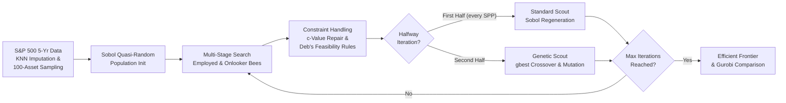
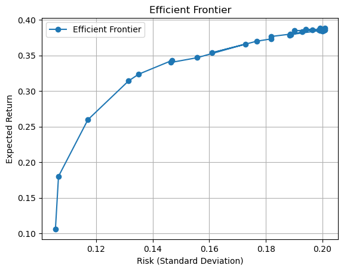

<div align="center">

# Modified Artificial Bee Colony (ABC) for Cardinality-Constrained Portfolio Optimization

[](https://www.python.org/)
[](https://numpy.org/)
[](https://scipy.org/)
[](https://optuna.org/)
[](https://www.gurobi.com/)
[](https://jupyter.org/)

*A Master's thesis research implementation exploring enhanced Artificial Bee Colony (ABC) metaheuristics for solving the NP-hard Cardinality-Constrained Mean-Variance (CCMV) portfolio optimization problem on S&P 500 equities, benchmarked against an exact Gurobi MIQP solver.*

</div>

---

## Overview

Classical Markowitz Mean-Variance (MV) portfolio optimization is a convex quadratic program that can be solved efficiently, but real-world institutional portfolios impose practical trading restrictions:

- **Cardinality Constraint** — limiting the portfolio to exactly $K$ active assets to control management overhead and transaction costs.
- **Quantity (Buy-in & Ceiling) Constraints** — enforcing lower and upper allocation bounds ($\varepsilon_i \le x_i \le \delta_i$) on every selected asset to avoid negligible positions and excessive concentration.

Adding these constraints turns the problem into a **Cardinality-Constrained Mean-Variance (CCMV)** Mixed-Integer Quadratic Program (MIQP), which is **NP-hard** and scales poorly for exact solvers as the asset universe grows.

This repository implements an iterative progression of **Modified Artificial Bee Colony (ABC)** algorithms designed specifically for CCMV portfolio optimization over a 100-asset S&P 500 pool, combining quasi-random Sobol initialization, multi-stage `pbest`/`gbest`-guided search, Deb's feasibility-based constraint handling, heuristic cardinality repair, genetic scout regeneration, and Optuna hyperparameter optimization.

---

## Mathematical Formulation

Given a universe of $N$ assets with expected daily returns $\mu_i$ and return covariance matrix $\Sigma = (\sigma_{ij})_{N \times N}$, the CCMV optimization problem parameterized by risk-aversion coefficient $\lambda \in (0, 1]$ is formulated as:

$$\min_{x,\, z} \; \lambda \sum_{i=1}^{N} \sum_{j=1}^{N} x_i x_j \sigma_{ij} \;-\; (1 - \lambda) \sum_{i=1}^{N} x_i \mu_i$$

subject to:

$$\begin{aligned}
\sum_{i=1}^{N} x_i &= 1 & & \text{(Budget constraint)} \\
\sum_{i=1}^{N} z_i &= K & & \text{(Cardinality constraint)} \\
\varepsilon_i z_i \le x_i &\le \delta_i z_i, \quad i = 1, \dots, N & & \text{(Quantity / box constraints)} \\
z_i &\in \{0, 1\}, \quad i = 1, \dots, N & & \text{(Binary asset selection)}
\end{aligned}$$

| Symbol | Description | Default Value in Experiments |
| :--- | :--- | :--- |
| $N$ | Total number of candidate assets in the pool | `100` (S&P 500 subset) |
| $K$ | Target number of assets in the portfolio (cardinality) | `15` |
| $\lambda$ | Investor risk-aversion parameter ($\lambda \to 1$: min risk; $\lambda \to 0$: max return) | 40-point sweep in `[0.001, 1.0]` |
| $\varepsilon_i, \delta_i$ | Minimum and maximum weight bounds for selected assets | `[0.001, 0.40]` |
| $x_i, z_i$ | Continuous portfolio weight and binary selection indicator for asset $i$ | Continuous / Binary |

---

## Algorithmic Architecture

The final solver (`6_CCMV_100asset_sobel_initilization_and_2_step_global_search_and_genetic_scout.ipynb`) extends the standard Artificial Bee Colony framework across four main components:



### Key Enhancements Over Vanilla ABC

1. **Quasi-Random Sobol Initialization** (`scipy.stats.qmc.Sobol`)
   Replaces purely uniform random initialization with low-discrepancy Sobol sequences scaled to $[\varepsilon, \delta]$ to improve initial search-space coverage.
2. **Multi-Stage Exploration & Exploitation Schedule** (`get_expo_way`)
   Dynamically switches search behavior within each Scout Production Period (`SPP`) across three modes controlled by thresholds `(s1, s2)`:
   - **Stage 0 (Standard ABC Search):** Neighborhood perturbation against a random peer solution $k$, mapping binary selection variables $z_{i,j}$ through a shifted sigmoid transfer function.
   - **Stage 1 (PSO-Inspired `pbest`/`gbest` Guided Search):** Directs continuous weights and binary selections toward both each food source's personal best and the global best solution to accelerate convergence.
   - **Stage 2 (Stochastic Binary Perturbation):** Randomly re-samples binary asset selections to maintain diversity and avoid premature stagnation.
3. **Hybrid Constraint Handling (Repair + Feasibility Rules)**
   - **Heuristic Cardinality Repair (`arrangement2`):** Adjusts active asset counts to match $K$ using a 50/50 mix of random selection and an asset-level risk-adjusted score ($c$-value, analogous to a shifted Sharpe-like ratio), followed by weight normalization.
   - **Deb's Method & Violation-Aware Roulette Selection:** Ranks candidate solutions by prioritizing feasible solutions over infeasible ones (comparing total bound violation when infeasible, and fitness when feasible), while allowing infeasible solutions nonzero selection probability in the onlooker phase.
4. **Genetic Scout Phase** (`scout_bee_genetic`)
   In the second half of the optimization budget, exhausted nectar sources (exceeding stagnation `limit`) are regenerated via uniform crossover between the global best solution and active peers plus small differential mutation rather than blind random restarts.
5. **Automated Hyperparameter Tuning (`Optuna`)**
   Runs a 100-trial Optuna study optimizing `population_size`, stagnation `limit`, `max_algo_iter_nums`, and `SPP`.

---

## Dataset & Experimental Setup

- **Market Data:** 5 years of historical daily S&P 500 constituent closing prices (`2013-02-08` to `2018-02-07`, 1,258 trading days).
- **Preprocessing (`Data processing.ipynb`):** Daily return computation, missing-value imputation via `KNNImputer(n_neighbors=2)`, and estimation of expected return vectors and covariance matrices for a 30-asset ETF-based pool and a randomly sampled 100-asset pool (`data/asset pool/SP500_100_assets_pool2.csv`).
- **Benchmarking (`CCMV_Gurobi.ipynb` / `CCMV_Gurobi-test.ipynb`):** Exact solver reference built with **Gurobi Optimizer** (`gurobipy`) over the same 100-asset covariance/return matrix.
- **Optuna Best Configuration (100 trials at $\lambda = 0.64$):** `population_size = 150`, `limit = 100`, `max_algo_iter_nums = 400`, `SPP = 50`.

---

## Experimental Results

### Efficient Frontier Visualization

<div align="center">
  
  <br />
  <em>Annualized Risk–Return Efficient Frontier generated by the ABC-CCMV solver across a 40-point risk-aversion sweep (N = 100, K = 15).</em>
</div>

### Frontier Summary Across Algorithm Iterations

Summary statistics across the 40-point efficient frontier sweep recorded in `Result Measurement.ipynb` (annualized return and annualized standard deviation):

| Variant | Notebook | Mean Return | Mean Risk (Std) | Median Return | Median Risk (Std) |
| :--- | :--- | :---: | :---: | :---: | :---: |
| **Gurobi Reference (`ucef`)** | `CCMV_Gurobi-test.ipynb` | 36.59% | 17.90% | 39.01% | 19.44% |
| **Baseline ABC (Deb's Method)** | `4_CCMV_...quantity_satisfied.ipynb` | 36.12% | 18.15% | 38.50% | 19.76% |
| **Sobol Init + Global Search** | `2_CCMV_...global_search.ipynb` | 36.09% | 18.15% | 38.51% | 19.78% |
| **ABC + Genetic Scout** | `3_CCMV_...genetic.ipynb` | 36.36% | 18.34% | 38.67% | 20.00% |
| **Sobol + Multi-Step Global Search** | `5_CCMV_...2_step_global_search.ipynb` | 36.36% | 18.12% | 38.71% | 19.48% |
| **Full Modified ABC (Sobol + Multi-Step + Genetic Scout)** | `6_CCMV_...genetic_scout.ipynb` | **36.54%** | **17.95%** | **38.79%** | **19.52%** |

> **Note:** Each successive variant reflects incremental ablations from the thesis experiments; recorded efficient frontier CSV outputs are stored in [`result/abc-ef.csv`](result/abc-ef.csv).

---

## Repository Structure

```text
.
├── Data processing.ipynb                                                   # S&P 500 cleaning, KNN imputation & asset pool generation
├── MY ABC Portfolio Optimization 15 asset pool.ipynb                       # Early prototype on a 15-asset pool
├── 0_ABC-MV Portfolio Optimization 100 asset pool.ipynb                    # Unconstrained MV baseline with ABC (100 assets)
├── 1_My_ABC_100_asset_pool_CCMV.ipynb                                      # Initial CCMV formulation with binary selection & repair
├── 2_CCMV_100asset_initilization_and_global_search.ipynb                   # + Sobol initialization & pbest/gbest search
├── 3_CCMV_100asset_pool_genetic.ipynb                                      # + Genetic crossover/mutation in scout phase
├── 4_CCMV_100asset_pool_quantity_satisfied.ipynb                           # + Deb's method & violation-aware roulette selection
├── 5_CCMV_100asset_sobel_initilization_and_2_step_global_search.ipynb      # + Multi-stage search schedule (SPP phases)
├── 6_CCMV_100asset_sobel_initilization_and_2_step_global_search_and_genetic_scout.ipynb  # Final integrated solver + Optuna tuning
├── CCMV_Gurobi.ipynb                                                       # Exact Gurobi MIQP benchmark (100-point frontier)
├── CCMV_Gurobi-test.ipynb                                                  # Exact Gurobi benchmark (40-point sweep & single-point test)
├── Result Measurement.ipynb                                                # Frontier comparison & summary metrics
├── data/
│   ├── SP500.csv                                                           # 5-year S&P 500 daily price dataset
│   ├── asset pool/
│   │   ├── SP500_100_assets_pool.csv                                       # Precomputed mean/covariance matrix (pool 1)
│   │   └── SP500_100_assets_pool2.csv                                      # Precomputed mean/covariance matrix (pool 2, used in experiments)
│   └── individual/                                                         # Raw constituent stock scripts and data
├── result/
│   └── abc-ef.csv                                                          # Recorded efficient frontier data points
├── images1/                                                                # Mathematical diagrams and frontier plots
└── environment.yml                                                         # Conda environment export
```

---

## Getting Started

### Prerequisites

Install the core scientific Python stack (Python 3.10+ recommended):

```bash
pip install numpy pandas scipy matplotlib scikit-learn optuna jupyter
```

Or recreate the original Conda environment:

```bash
conda env create -f environment.yml
```

*(Optional)* To run the exact benchmark notebooks (`CCMV_Gurobi.ipynb`), install `gurobipy` with a valid Gurobi academic or commercial license:

```bash
pip install gurobipy
```

### Running the Experiments

1. Clone the repository and launch Jupyter:
   ```bash
   git clone https://github.com/Shenyun/Modified_ABC_CCMV_portfolio_optimization.git
   cd Modified_ABC_CCMV_portfolio_optimization
   jupyter notebook
   ```
2. Open [`6_CCMV_100asset_sobel_initilization_and_2_step_global_search_and_genetic_scout.ipynb`](6_CCMV_100asset_sobel_initilization_and_2_step_global_search_and_genetic_scout.ipynb) (data paths are preconfigured relative to the repository root).
3. Run the cells sequentially to reproduce single-$\lambda$ convergence curves, the 40-point efficient frontier, or the Optuna hyperparameter search.

---

## Roadmap & Potential Improvements

As a research-era notebook codebase, several engineering upgrades would be natural next steps for production or further benchmarking:

- **Modularization:** Extract shared solver logic (`Nectar`, operators, repair functions, evaluation) from notebooks into a reusable Python package (`src/`) with config-driven relative paths and unit tests.
- **Vectorization & Performance:** Vectorize population fitness and quadratic form evaluations (`W @ Sigma @ W.T`) to scale experiments to larger asset universes ($N \ge 500$).
- **Extended Evaluation:** Add out-of-sample rolling-window backtesting, turnover/transaction-cost constraints, and multi-seed statistical significance tests against other metaheuristics (e.g., PSO, GA, DE).

---

## References

- Markowitz, H. (1952). *Portfolio Selection*. The Journal of Finance, 7(1), 77–91.
- Chang, T.-J., Meade, N., Beasley, J. E., & Sharaiha, Y. M. (2000). *Heuristics for cardinality constrained portfolio optimisation*. Computers & Operations Research, 27(13), 1271–1302.
- Karaboga, D., & Basturk, B. (2007). *A powerful and efficient algorithm for numerical function optimization: artificial bee colony (ABC) algorithm*. Journal of Global Optimization, 39(3), 459–471.
- Deb, K. (2000). *An efficient constraint handling method for genetic algorithms*. Computer Methods in Applied Mechanics and Engineering, 186(2–4), 311–338.
- Cura, T. (2009). *Particle swarm optimization approach to portfolio optimization*. Nonlinear Analysis: Real World Applications, 10(4), 2396–2406.

---

<div align="center">
  <sub>Author: Bian Hanzhang</sub>
</div>
